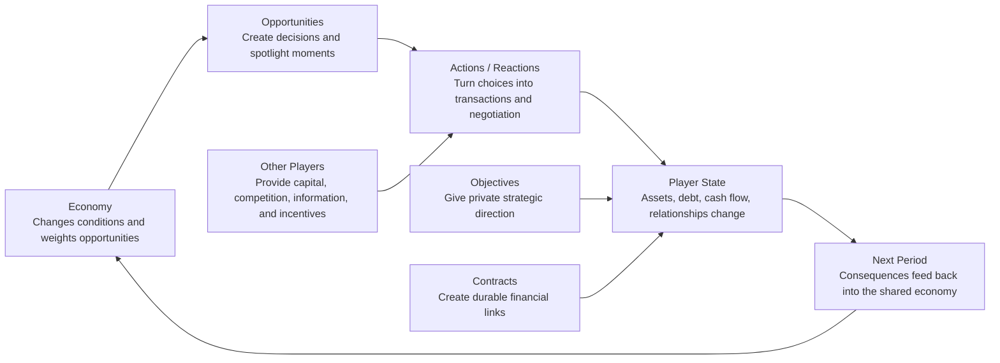

# Financial Strategy Game

## Canonical Game Design Specification

Agreed game systems, prototype financial rules, and implementation handoff.

> **Version:** 0.3  
> **Date:** September 5, 2026  
> **Status:** Pre-implementation baseline

### Purpose

This specification is the source of truth for the game. The core design is established; numerical values form the first prototype baseline. Balance, duration, and unresolved implementation rules require validation before release.

### Design guardrail

> **For V1, complexity should come primarily from player decisions, incentives, incomplete information, and the shared economy - not from a large number of special-case rules.**

# How to use this specification

LOCKED marks an agreed design rule. PROTOTYPE marks the current numerical baseline, which can change through testing. TENTATIVE marks a proposed implementation approach. OPEN identifies an unresolved decision. POST-V1 excludes a feature from the first playable version.

| **Status**    | **Meaning**                                                             | **Treatment**                                                  |
|---------------|-------------------------------------------------------------------------|----------------------------------------------------------------|
| **LOCKED**    | Core direction has been agreed.                                         | Do not reopen casually; change only for a clear design reason. |
| PROTOTYPE     | Concrete numerical baseline; not yet simulation- or playtest-validated. | Implement, test, and revise through versioned balance changes. |
| **TENTATIVE** | Promising approach, not yet fully specified.                            | Use as a working assumption and validate in playtests.         |
| **OPEN**      | A material decision remains unresolved.                                 | Resolve during specification or implementation planning.       |
| **POST-V1**   | Useful idea deliberately deferred.                                      | Do not let it expand V1 scope.                                 |

> **MAINTENANCE RULE** Whenever a new mechanic is proposed, ask whether it meaningfully improves strategy, player interaction, financial learning, or pacing. If it does not, it should probably remain outside V1.

# Core game at a glance

| **Area**          | **Canonical direction**                                                                                                                                                             |
|-------------------|-------------------------------------------------------------------------------------------------------------------------------------------------------------------------------------|
| **Platform**      | Browser-based; responsive on phone and laptop.                                                                                                                                      |
| **Play context**  | Designed first for people playing together in the same room.                                                                                                                        |
| **Communication** | Vocal negotiation is expected; V1 does not need in-game chat.                                                                                                                       |
| **Structure**     | Shared economy with dynamic spotlight turns, meaningful background activity, and four randomly assigned unique starting profiles.                                                   |
| **Interaction**   | Players can finance, partner with, sell to, buy from, and compete with one another when incentives align.                                                                           |
| **Information**   | Public position, private details; opportunities may begin private.                                                                                                                  |
| **Victory**       | Eight unique hidden objectives; each player chooses privately between two compatible choices; eligibility unlocks a risky culminating move rather than ending the game immediately. |
| **Difficulty**    | Easy to read, difficult to judge; same simulation for novice and expert players.                                                                                                    |
| **V1 philosophy** | Simple reusable systems; emergent complexity; minimize edge cases.                                                                                                                  |

# 1. Game identity and design pillars [LOCKED]

The game is a multiplayer financial strategy simulation inspired by the learning-by-doing appeal of CASHFLOW, but designed to remain strategically interesting after players understand the basic mechanics. It should feel less like solving a fixed financial formula and more like operating inside a shared, uncertain economy with other self-interested players.

## 1.1 Design pillars

- **Shared economy.** All players operate in one evolving financial world, so the same economic change can help one player and hurt another.

- **Self-interested interaction.** Cooperation is allowed and encouraged when incentives align, but players remain individual competitors in V1.

- **Imperfect information.** Players understand broad positions and market conditions without having perfect visibility into exact finances, private opportunities, intentions, or objectives.

- **Simple surface, deep underneath.** A newcomer should understand what a choice means without needing prior finance knowledge, while an expert can inspect deeper assumptions and second-order effects.

- **Unpredictable but coherent.** Randomness creates surprise, while economic momentum and eligibility rules keep outcomes from feeling arbitrary.

- **Social by design.** The software facilitates financial truth and formal transactions; the people at the table provide persuasion, bluffing, trust, promises, and negotiation.

- **Controlled duration, uncertain ending.** The game should resist multi-hour drift without announcing a fixed final round or visible countdown.

## 1.2 Presentation direction

The first version should use a clean dashboard-oriented interface rather than 3D. The player should be able to understand personal finances, the shared economy, the current spotlight, and the general condition of other players from a responsive interface.

- Phone and laptop are both first-class targets. Exact layout differences remain to be specified.

- A shared TV/display mode may be attractive later, but it is not important enough to drive V1 architecture or UX.

- 3D is explicitly outside the initial target. It can be reconsidered much later only if spatial representation adds gameplay rather than decoration.

# 2. Core gameplay loop [LOCKED]

> **CORE PRINCIPLE** There is an active player, but there should rarely be an inactive player. One player has the spotlight; everyone else can still inspect, plan, talk, and react when invited.

## 2.1 Round rhythm

1.  Shared economic update: the world changes for everyone at once.

2.  Position preview: show the updated economy, asset estimates, obligations, and expected quarterly cash flow. Do not pay recurring income at this point.

3.  Simultaneous planning: players inspect their position, select focus, prepare actions, and talk.

4.  Spotlight sequence: one player at a time gets authority to initiate or resolve a meaningful opportunity or prepared action.

5.  Reaction windows: other players may formally respond when the spotlight creates a financing, sale, partnership, bid, or contract decision.

6.  Transaction resolution: the active deal closes, fails, or is declined; immediate purchase, sale, and financing cash movements are recorded.

7.  Round close: resolve shared consequences and settle the full quarter of recurring income, expenses, debt service, and contracts once. Update private objective eligibility.

8.  Next economic period begins. There is no separate second payout for the same quarter.

## 2.2 Spotlight pacing

Spotlights should not have a predictable cadence. Quick decisions are most common, but major decisions can occur at any time, including consecutively. Category and intensity are separate dimensions.

| **Intensity** | **Typical feel**                                     | **Examples**                                                            |
|---------------|------------------------------------------------------|-------------------------------------------------------------------------|
| **Quick**     | Often 15-45 seconds; one clear decision.             | Small investment, simple career choice, basic refinancing offer.        |
| **Standard**  | Requires comparison or light investigation.          | Rental deal, business expansion, financing choice.                      |
| **Major**     | Potentially several minutes; may become multiplayer. | Acquisition, major sale, crisis, contested asset, large financing need. |

> **TUNING NOTE** Exact probabilities and time ranges are not locked. The important rule is that quick spotlights dominate without creating a predictable pattern; late-game conditions may increase the weight of major opportunities.

## 2.3 Dynamic turns

The game should not feel like a strict Player 1 -\> Player 2 -\> Player 3 -\> Player 4 board-game loop. Other players remain engaged while one player has the spotlight; the financial simulation advances at defined state transitions, not continuously in real time. Reactions and triggered opportunities may involve others, but the active transaction stays central until it resolves.

- Reaction participation does not normally consume the reacting player's later spotlight.

- The exact algorithm for selecting the next spotlight is still open.

# 3. Actions, reactions, and transaction timing [LOCKED]

V1 should use a strict state model so that social freedom does not create rules ambiguity: players may always think and talk, but only certain states allow game-state changes.

| **State**      | **What the player may do**                                                                             | **What the player may not do**                        |
|----------------|--------------------------------------------------------------------------------------------------------|-------------------------------------------------------|
| **Background** | Inspect, research, plan, review objective, talk, draft an offer or future action.                      | Commit unrelated financial transactions.              |
| **Spotlight**  | Initiate and complete one meaningful transaction sequence or resolve the presented opportunity.        | Start unlimited unrelated major actions.              |
| **Reaction**   | Respond to the active transaction: offer, bid, accept, counter, decline, or exercise a relevant right. | Use the reaction window to launch unrelated activity. |

## 3.1 Active transaction rule

> **V1 RULE** Only one major transaction should be formally unresolved at a time. Players may prepare future actions in the background, but the game does not maintain multiple simultaneous unresolved deal chains.

A single transaction may still contain several steps - investigate, negotiate financing, add a partner, choose loan terms, and close - without counting each button press as a separate action. The spotlight follows the player's intent.

## 3.2 Reaction scope

A reaction exists only because the active transaction affects another player or explicitly invites them in. V1 should avoid recursive reaction chains: a player responding to Maya's financing request cannot open a new formal financing request to Owen in order to fund that reaction. Verbal promises can still reference future behavior.

| **Trigger**                    | **Allowed reaction**                   |
|--------------------------------|----------------------------------------|
| **Capital request**            | Offer / pass / negotiate allowed terms |
| **Asset sale**                 | Bid / pass                             |
| **Partnership proposal**       | Accept / counter / decline             |
| **Shared scarce opportunity**  | Bid / pass                             |
| **Existing contract decision** | Accept / exercise / decline            |

## 3.3 Shared-market fairness

Spotlight order should matter for scarce opportunities, not arbitrary changes in shared market prices or standard bank terms. Terms may remain fixed for the economic period unless an explicit event changes them. Preparation alone never executes an order; exact public-market execution and settlement timing remains an implementation decision.

# 4. Player interaction, negotiation, contracts, and promises [LOCKED]

## 4.1 Same-room social model

V1 assumes players are physically together and can speak. The interface should prompt conversation rather than replace it. No in-game chat system is required for the first version.

> **UI PRINCIPLE** Phones should prompt conversation, not replace it. The software structures offers and enforces agreed terms; players conduct the negotiation aloud.

## 4.2 Targeted vs public requests

Players should have two ways to seek capital, partners, or buyers. The choice itself carries strategic information costs.

| **Mode**             | **Strategic trade-off**                                                                                                                                  |
|----------------------|----------------------------------------------------------------------------------------------------------------------------------------------------------|
| **Targeted request** | Approach one specific player. Less information leakage, potentially faster, but no competition among counterparties.                                     |
| **Open request**     | Publish the need or offer to all eligible players. More competition and potentially better terms, but reveals information about your position or intent. |

For open requests, V1 can use a simple formal cadence: interested players submit an initial offer; the initiator may request one final-offer round; then the initiator chooses or rejects all offers. Players may negotiate verbally throughout.

## 4.3 Contracts vs promises

| **Type**     | **How it appears**                                                                      | **Enforcement**                            |
|--------------|-----------------------------------------------------------------------------------------|--------------------------------------------|
| **Promise**  | Anything players say aloud that is not entered and mutually confirmed in the game.      | Social only. The game does not enforce it. |
| **Contract** | A supported transaction entered through the game and confirmed by all required parties. | Automatically enforced by the game.        |

Players do not choose from a Promise vs Contract menu. They choose whether to formalize supported terms. A formal contract and informal promises may coexist in the same negotiation.

- V1 contract types should stay simple: loans, equity investments/partnership ownership, and asset sales are sufficient foundations.

- Complex conditional clauses and legal-style branching terms are outside V1.

- Only terms represented and confirmed in the interface are binding; additional verbal commitments remain promises.

# 5. Public and private information [LOCKED]

> **CORE RULE** Public position, private details. Everyone should understand roughly how others are doing without seeing the exact resources, constraints, intentions, or objectives behind their choices.

| **Information class**       | **Examples**                                                                                                                          | **Visibility**                      |
|-----------------------------|---------------------------------------------------------------------------------------------------------------------------------------|-------------------------------------|
| **Public position**         | Major assets, controlled businesses, known partnerships, major completed transactions, broad liquidity/leverage/cash-flow indicators. | All players                         |
| **Private finances**        | Exact cash, debt payments, borrowing capacity, constraints, and prepared actions; no detailed tax model in V1.                        | Owner only                          |
| **Opportunity information** | Full details of a privately discovered deal, due-diligence findings, seller-specific information.                                     | Discoverer until revealed or shared |
| **Transaction information** | Existence of ownership/partnership and some public terms; supported private terms may remain hidden.                                  | Partial / context-dependent         |
| **Objective**               | Private ambition and exact victory requirements.                                                                                      | Owner only                          |

Exact visibility thresholds and which contract terms are public remain implementation decisions. A targeted request limits what the software discloses; people in the same room may still overhear spoken negotiation. Private information must not be sent to unauthorized player clients.

# 6. Opportunity system [LOCKED]

An opportunity is any situation presented to a player that requires a meaningful financial or strategic decision. The engine should create a coherent eligible pool rather than draw blindly from one giant deck.

## 6.1 V1 opportunity families

| **Family**           | **Typical content**                                         | **V1 intent**                                                |
|----------------------|-------------------------------------------------------------|--------------------------------------------------------------|
| **Career**           | Promotion, job change, relocation, education.               | Keep earning/career progression viable.                      |
| **Real estate**      | Acquire, refinance, renovate, sell, distressed purchase.    | Support ownership, debt, cash flow, and valuation decisions. |
| **Business**         | Start, acquire, expand, contract, sell.                     | Create growth and multiplayer capital needs.                 |
| **Markets**          | Public investments and selected private opportunities.      | Provide liquid capital allocation choices.                   |
| **Finance**          | Loans, refinancing, restructuring, credit decisions.        | Connect economic rates to player decisions.                  |
| **Life / strategic** | Major expense, relocation, lifestyle or personal trade-off. | Add context without becoming random punishment.              |

## 6.2 Selection logic

Ordinary opportunities follow: eligible candidates -\> weights from current player state, economy, focus, recent history, and game phase -\> seeded random selection. The hidden objective does not improve ordinary opportunity odds. Objective-specific culminating moves are the explicit exception.

- Players may select a focus area such as real estate, business, career, markets, financing, or general opportunities. Focus increases probability; it never guarantees a desired deal.

- Opportunity category and intensity are independent. A real-estate opportunity can be quick or major; a career opportunity can also be major.

- Declining should be common and strategically legitimate. An opportunity means something worth considering, not automatically something worth buying.

## 6.3 Access and information layers

| **Access state** | **Meaning**                                                          | **Example**                                                   |
|------------------|----------------------------------------------------------------------|---------------------------------------------------------------|
| **Private**      | Initially visible only to the discovering player.                    | A seller privately approaches the player.                     |
| **Public**       | Visible to everyone; eligibility controls execution, not visibility. | Auction or public sale.                                       |
| **Triggered**    | Created by a player action or existing ownership.                    | A company sale creates an acquisition opportunity for others. |

Information is layered: basic facts -\> optional investigation -\> decision. Keep due diligence shallow, generally no more than two information levels. The complete asset facts are generated at discovery; investigation reveals existing fields and never rerolls the deal. Investigation costs and access rules remain template parameters.

## 6.4 Opportunity behavior

- **Expiration.** Opportunities do not remain forever; many expire within the current round or a short window.

- **Escalation.** A quick-looking opportunity can occasionally reveal a major deal, and a major-looking deal can collapse quickly after investigation.

- **Ownership-linked content.** Existing businesses and assets unlock relevant future opportunities, making player history shape future gameplay.

- **Economic weighting.** Booms, slowdowns, recessions, and credit conditions alter which opportunities are more likely.

- **No direct quality label.** The game shows trade-offs and information, not a GOOD DEAL / BAD DEAL verdict.

## 6.5 V1 content architecture

V1 should favor reusable templates rather than hundreds of bespoke code paths. A target on the order of 60-80 authored templates was proposed as a practical prototype range, but the final count should be determined by repetition observed in playtests.

| **Template field**               | **Purpose**                                              |
|----------------------------------|----------------------------------------------------------|
| **Category / intensity**         | Classifies the opportunity and pacing impact.            |
| **Eligibility conditions**       | Determines which players can plausibly receive it.       |
| **Weight**                       | Controls relative probability after eligibility.         |
| **Access state**                 | Private, public, or triggered.                           |
| **Initial / investigation info** | Controls layered disclosure.                             |
| **Available actions**            | Defines supported choices and reaction windows.          |
| **Outcome formula**              | Maps choice plus economy/player state into consequences. |
| **Duration**                     | Controls expiry and urgency.                             |

# 7. Economic simulation [LOCKED]

The economy should be deep enough to create coherent consequences and changing strategy, but simple enough that players can understand the current environment at a glance.

## 7.1 Shared visible indicators

| **Indicator**           | **Role**                                                                   |
|-------------------------|----------------------------------------------------------------------------|
| **Base interest rate**  | Affects borrowing cost, floating debt, refinancing, and cash yield.        |
| **Economic activity**   | Represents broad strength or weakness in demand and employment conditions. |
| **Inflation**           | Changes cost pressure and may influence rates and pricing power.           |
| **Credit availability** | Controls how easy and expensive financing is to obtain.                    |

Property values, business performance, markets, employment, and opportunity weights should be downstream consequences of these shared conditions rather than completely independent random modifiers.

## 7.2 Hidden regime and momentum

Under the visible indicators, the engine may track a hidden regime such as expansion, overheating, slowdown, recession, and recovery. Players should never see a stage counter. Transitions are probabilistic, and the economy should usually move with momentum rather than redraw itself randomly each round.

> **SIMULATION RULE** Next economy = current state + momentum + bounded randomness + event effects. Randomness creates uncertainty; state continuity makes planning meaningful.

## 7.3 Consequences should be asymmetric

| **Economic change** | **Potential winners**                                                | **Potential losers**                                                 |
|---------------------|----------------------------------------------------------------------|----------------------------------------------------------------------|
| **Rates rise**      | Cash-heavy players, lenders, fixed-rate borrowers relative to peers. | Floating-rate borrowers, new borrowers, highly leveraged assets.     |
| **Economy weakens** | Cash-rich distressed buyers, defensive assets.                       | Cyclical businesses, vulnerable employment, weak tenants.            |
| **Inflation rises** | Some pricing-power businesses and selected real assets.              | Fixed margins, cost-sensitive businesses, borrowers if rates follow. |
| **Credit tightens** | Players with liquidity and little financing need.                    | Players dependent on refinancing or external capital.                |

## 7.4 Asset sensitivity and randomness

Assets should react differently using a small shared model. A business can have low/medium/high economic sensitivity; a property can differ by occupancy, condition, rent, expenses, and debt structure. Individual asset randomness adds variation, but the macro economy remains the main source of coherence.

- Cash flow and valuation are distinct. An asset may keep producing income while its market value falls, or vice versa.

- Fixed and variable debt should both exist in V1 because the trade-off is intuitive and connects directly to the shared economy.

- Economic events change the world; opportunities ask players what to do about the changed world. Avoid pure random punishment cards.

## 7.5 Forecasting

Players may receive imperfect qualitative outlooks such as persistent inflation, weakening business confidence, or tightening credit. Forecasts should support reasoning without guaranteeing the next state.

# 8. Starting conditions and progression [LOCKED]

Starting position, progression, and objectives form one connected system: the starting profile determines what is easy now, the objective determines the desired end state, and the economy, opportunities, and other players determine how the route actually unfolds.

## 8.1 V1 setup and profile assignment

- V1 is designed around four players.

- Four unique starting profiles are randomly assigned from a pool of eight; players do not choose or reroll profiles in V1.

- The profile name and broad financial shape are public. Exact balances, debt payments, borrowing capacity, and other detailed finances remain private.

- Profiles are not character classes and grant no special powers. They are simply different initial balance sheets, income structures, ownership positions, and opportunity access.

- Each profile must begin with at least one meaningful form of economic power and at least one real constraint; V1 should not include a deliberately disadvantaged "poor beginner" profile.

> **PROFILE PRINCIPLE** A starting profile should shape the opening strategy without determining the ending strategy.

## 8.2 V1 starting-profile set

| **Profile**                  | **Starting shape**                                                                                         | **Opening power / constraint**                                                                                                |
|------------------------------|------------------------------------------------------------------------------------------------------------|-------------------------------------------------------------------------------------------------------------------------------|
| **High-Income Professional** | Very high salary; moderate cash and debt; high expenses; modest investments.                               | Strong cash generation and borrowing capacity; heavily dependent on employment and expensive to make financially independent. |
| **Corporate Climber**        | Above-average income; moderate liquidity; modest assets; strong promotion/equity upside.                   | Future career progression is the main advantage; the player does not start especially wealthy.                                |
| **Disciplined Saver**        | Moderate income; very high cash; very low debt; modest existing investments.                               | Exceptional flexibility and resilience; once cash is deployed badly, it rebuilds more slowly than for high-income profiles.   |
| **Small Business Owner**     | Controlling stake in a small operating company; variable income; moderate debt; limited diversification.   | Immediate productive ownership and business opportunities; concentrated exposure to one company.                              |
| **Property Starter**         | Moderate income; one income-producing property; low/moderate liquidity; relatively high leverage.          | Existing equity and property access; vulnerable to vacancies, repairs, and financing conditions.                              |
| **Market Investor**          | Moderate income; substantial liquid market portfolio; low debt; little operating ownership.                | Liquid diversified capital; exposed to market swings and starts with little business/property control.                        |
| **Self-Employed Operator**   | Good but variable earned income; moderate cash; low/moderate debt; small operation dependent on the owner. | Flexible earning power and a path to scale; most current income stops if the owner stops working.                             |
| **Early-Stage Entrepreneur** | Low salary and liquidity; modest young company; low/moderate debt; meaningful growth potential.            | Highest upside and early growth/capital-raising access; fragile finances and concentrated risk.                               |

## 8.3 Progression without levels

There is no XP, investor level, or conventional skill-tree progression. The player's financial position is the progression system. Liquidity, income/cash flow, credit, ownership, career progress, business scale, and relationships make larger opportunities naturally become plausible.

- Early decisions should generally be smaller, forgiving, and easy to reason about. Complexity grows as players accumulate assets, debt, contracts, and ownership relationships.

- Career progression remains a viable wealth engine rather than merely something players are expected to escape.

- Social capacity matters. A player who cannot fund an opportunity alone may still become eligible if another player can supply capital or join as a partner.

- Profiles should matter most in the early game. Over time, the consequences of player decisions should matter more than the hand they were dealt at setup.

## 8.4 Broad wealth engines

| **Engine** | **Meaning**                                             | **Typical examples**                                         |
|------------|---------------------------------------------------------|--------------------------------------------------------------|
| **Earn**   | Build active income and career capacity.                | Salary, promotion, bonuses, executive compensation.          |
| **Own**    | Build wealth through productive assets and equity.      | Businesses, real estate, public/private investments.         |
| **Deal**   | Use relationships and transactions to allocate capital. | Lending, partnerships, acquisitions, player-to-player sales. |

Successful strategies may combine all three. Objectives emphasize different mixes while using the same underlying systems.

## 8.5 Capacity-based progression [LOCKED]

There is no single player-power score. Evaluate the current position across five dimensions, without permanent profile bonuses or relationship levels.

| **Dimension**      | **What the engine evaluates**                                                                                |
|--------------------|--------------------------------------------------------------------------------------------------------------|
| Liquidity          | Cash and accessible investments; illiquid equity is not automatically spendable.                             |
| Income / cash flow | Recurring earning power, distributions, and ability to support obligations.                                  |
| Credit capacity    | Current reserves, income stability, obligations, collateral, and credit conditions.                          |
| Ownership scale    | Size and quality of controlled businesses, property, and investment stakes.                                  |
| Deal capacity      | A plausible route to assemble capital, including partners and supported financing; not a social-trust score. |

Foundation, Established, Scaled, and Endgame-capable are internal descriptive bands, not visible levels or permanent unlocks. Opportunity scale and complexity expand as the position improves; losses or a large purchase can reduce immediate capacity again. Objective eligibility is specific to the chosen ambition, not a generic level.

## 8.6 Discovery is not execution [LOCKED]

| **Check**            | **Rule**                                                                                                                                                                    |
|----------------------|-----------------------------------------------------------------------------------------------------------------------------------------------------------------------------|
| Discovery            | Can this player plausibly pursue the opportunity from their current position? A credible financing route is sufficient; personal cash need not cover the whole transaction. |
| Execution            | Can the player complete this specific transaction now under valid cash, ownership, financing, and contract terms? Potential partner interest is not committed money.        |
| Public opportunities | Everyone sees them. Private feedback distinguishes ready to act, financing required, or partnership required. Only a valid funded transaction may close.                    |

Alternative routes include cash, cash plus borrowing, and cash plus committed partner capital. A spoken offer or prior relationship never transfers money by itself. Participation still obeys the one-active-transaction rule: reacting players cannot launch recursive borrowing chains to fund their reactions.

## 8.7 Hard gates, soft weights, and scale [LOCKED]

Filter impossible candidates using current capacity, required assets/history, and economic restrictions. Then weight eligible candidates by player-selected focus, current holdings, economic environment, recent opportunities, and game phase. Draw the opportunity and its terms using the seeded generator. Ordinary opportunity generation is objective-neutral.

Most deals should fit current capacity. Occasionally a larger opportunity can appear when an attainable financing route exists. Opportunity size and spotlight intensity are separate: a wealthy player can receive a large but quick choice, and a smaller deal can trigger difficult negotiation. Greater wealth must not eliminate useful small opportunities.

## 8.8 Ownership, history, and reversibility [LOCKED]

Current ownership creates related branches: owners can expand, refinance, accept contracts, sell stakes, or receive acquisition offers. Light history flags, such as a completed acquisition or performing loan, may support relevant access. They are not XP and cannot substitute for current affordability. Career progress is represented by the actual current role and compensation.

Reassess after relevant transactions and economic changes. High income can support debt; spending reserves can restrict new commitments; tight credit can make the same deal unfinanceable. Formal ownership and lending relationships can provide context, but informal trust stays with the people at the table.

## 8.9 Opportunity template additions [LOCKED]

| **Field**                | **Purpose**                                                                         |
|--------------------------|-------------------------------------------------------------------------------------|
| Capacity paths           | Alternative discovery and execution qualifications, rather than one cash threshold. |
| Asset / history tags     | Required ownership, career state, or lightweight transaction history.               |
| Scale range              | Small, medium, large, or major size parameters; not player levels.                  |
| External funding allowed | Whether supported bank, player, or partner funding can bridge the gap.              |
| Economic restrictions    | Availability and financeability under current conditions.                           |
| Weights and visibility   | Focus, holdings, recent history, economy; private, public, or triggered access.     |

Culminating moves reuse the same opportunity, financing, reaction, and transaction engines. Objective eligibility gives the player the right to seek a finale; random availability must not leave an otherwise qualified player waiting indefinitely for a card.

IMPLEMENTATION CHECK How discovery recognizes plausible external finance without guaranteeing cooperation or leaking other players' private balances remains to be specified in section 19.

# 9. Hidden objectives and victory [LOCKED]

> **IDENTITY STATEMENT** Everyone plays in the same economy, but everyone is secretly playing a different strategic game.

V1 uses eight hidden objective archetypes. Objectives are private, asymmetric, and financially thematic. They create strategic direction and deduction without exposing one universal formula for victory.

## 9.1 Objective assignment rules

- Each player is privately offered exactly two objectives after their starting profile is assigned, then privately chooses one.

- Players choose simultaneously; there is no first-pick advantage or public draft.

- All eight objective archetypes are dealt exactly once across the four two-option sets. Because offered sets do not overlap, the four final chosen objectives are automatically unique.

- The objective remains fixed for the match in V1. Objective pivots are deferred unless playtesting proves they are necessary.

- The owner can inspect the exact objective requirements. Other players cannot see the objective or its thresholds and must infer intent from behavior.

- The main dashboard should avoid a constant exact completion meter. Qualitative progress can be shown, while detailed requirements remain privately inspectable.

> **FAIRNESS RULE** Hidden information should create uncertainty between players, not uncertainty about the rules. A player should know exactly what their own objective requires.

## 9.2 Shared objective structure

Every objective follows the same high-level structure: build the required position -\> become eligible -\> successfully complete an objective-specific culminating move -\> win. Eligibility alone never ends the game.

- Each objective uses multiple conditions so a single inflated metric cannot produce an easy win.

- Objectives reward different reasons for using the same assets and transaction systems rather than creating eight separate minigames.

- Once eligible, a player gains the ability to pursue the culminating move; they do not have to wait for a lucky random card to make victory possible.

- Randomness may affect the terms and difficulty of the culminating move.

- A culminating move must put something meaningful at risk. A poor final decision can cause the player to lose eligibility instead of winning.

## 9.3 V1 objective archetypes

| **Objective**         | **Strategic identity**                                                              | **Culminating move**                                                                   |
|-----------------------|-------------------------------------------------------------------------------------|----------------------------------------------------------------------------------------|
| **Founder**           | Build and control a genuinely valuable operating company.                           | Major expansion, strategic acquisition, or successful exit.                            |
| **Property Magnate**  | Build a large, profitable, resilient real-estate portfolio.                         | Landmark acquisition; development can be considered later.                             |
| **Independent**       | Make employment financially optional through resilient non-salary income.           | Leave employment and remain financially qualified afterward.                           |
| **Capital Allocator** | Build wealth by owning diversified stakes rather than operating one dominant asset. | Make a major strategic investment while preserving portfolio strength.                 |
| **Financier**         | Profit by supplying capital and structuring financing for others and the market.    | Successfully fund a major transaction.                                                 |
| **Deal Maker**        | Create wealth through buying, selling, combining, and restructuring ownership.      | Complete a transformative acquisition, sale, or restructuring.                         |
| **Executive Owner**   | Reach high professional success while converting earning power into ownership.      | Take a major ownership-linked leadership position.                                     |
| **Wealth Architect**  | Build an exceptionally strong, balanced overall financial position.                 | Complete a major portfolio move while remaining strong across all required dimensions. |

### 9.3.1 Founder

- Rewards: entrepreneurship, reinvestment, expansion, acquisitions, financing, and intelligent ownership/control decisions.

- Eligibility: controlling interest in a sufficiently valuable operating business; strong positive operating profit; demonstrated sustainability; financially viable capital structure.

- Culmination: major expansion, strategic acquisition, or successful exit at a sufficiently strong outcome.

- Exploit guard: valuation or gross size alone is insufficient; reckless borrowing cannot manufacture eligibility.

### 9.3.2 Property Magnate

- Rewards: property acquisition, financing/refinancing, partnerships, occupancy/operations, and disciplined leverage.

- Eligibility: control of substantial income-producing real estate; meaningful positive property cash flow; sufficient diversification/scale; acceptable occupancy and leverage.

- Culmination: complete a landmark acquisition. Major development is a possible later extension, not a required V1 subsystem.

- Exploit guard: gross property value created by extreme leverage does not qualify without a working, resilient portfolio.

### 9.3.3 Independent

- Rewards: recurring non-employment cash flow, diversification, liquidity, controlled expenses, and financial resilience.

- Eligibility: sustainable non-employment income comfortably exceeds core expenses; income comes from more than one source; liquidity and debt position remain healthy.

- Culmination: formally leave employment or active self-employment; recalculate finances without labor-dependent earnings. Award victory only if the required independent position remains. The equivalent confirmation for a player already not working remains to be specified.

- Exploit guard: players cannot manufacture eligibility through a one-period income spike or an artificial last-second expense cut.

### 9.3.4 Capital Allocator

- Rewards: public investments, private stakes, minority ownership, partnerships, diversification, and disciplined capital deployment.

- Eligibility: substantial invested assets across several meaningful independent holdings; material investment income/value creation; no overwhelming dependence on one player-operated asset.

- Culmination: make a major strategic investment while retaining the required strength and diversification afterward.

- Exploit guard: tiny token positions do not count as diversification; holdings must be economically material.

### 9.3.5 Financier

- Rewards: lending, secured financing, structured capital, liquidity management, and borrower-risk judgment.

- Eligibility: substantial profit/income from financing; several meaningful performing financing positions; adequate liquidity and controlled default exposure.

- Culmination: successfully finance a transaction above a major scale threshold.

- Exploit guard: gross lending volume and reciprocal back-and-forth loans do not create progress without genuine capital exposure and earned returns.

### 9.3.6 Deal Maker

- Rewards: negotiated acquisitions, sales, partnerships, ownership stakes, restructurings, and realized value creation.

- Eligibility: meaningful realized wealth from several significant transactions across more than one asset or counterparty, plus a strong current position.

- Culmination: complete a transformative acquisition, sale, merger-like transaction, or restructuring.

- Exploit guard: repetitive low-value trades or cooperative circular transactions do not advance the objective; qualifying deals must be material and economically substantive.

### 9.3.7 Executive Owner

- Rewards: promotions, career decisions, executive opportunities, equity compensation, investing earned income, and building ownership alongside employment.

- Eligibility: high career tier/compensation, meaningful productive ownership, and a strong personal financial position.

- Culmination: accept or complete a major leadership opportunity with meaningful ownership exposure, such as an equity-heavy executive position or later management buy-in.

- Exploit guard: salary alone cannot satisfy the objective; earning power must be converted into ownership.

### 9.3.8 Wealth Architect

- Rewards: balanced wealth, cash flow, liquidity, diversification, controlled leverage, and resilience.

- Eligibility: strong simultaneous performance across several dimensions rather than dominance in one. Because this path is flexible, its thresholds should be comparatively demanding.

- Culmination: execute a major portfolio reallocation, acquisition, or debt/asset restructuring while remaining above all eligibility requirements afterward.

- Exploit guard: the generalist path must not become easier than specialized objectives merely because it allows more strategic freedom.

## 9.4 Objective strategic families

Families are internal generation tags used to create contrasting choices; they are not shown as classes to players.

| **Family**                    | **Objectives**               |
|-------------------------------|------------------------------|
| **Builders**                  | Founder; Property Magnate    |
| **Capital**                   | Capital Allocator; Financier |
| **Life / career**             | Independent; Executive Owner |
| **Transactions / generalist** | Deal Maker; Wealth Architect |

## 9.5 Profile-objective compatibility matrix

The matrix is an internal setup tool. S = Strong fit, V = Viable alternative, T = Stretch. Stretch objectives are not normally offered in V1. Compatibility ratings are never shown to players.

| **Profile**           | **FND** | **PM** | **IND** | **CA** | **FIN** | **DM** | **EO** | **WA** |
|-----------------------|---------|--------|---------|--------|---------|--------|--------|--------|
| **High-Income Pro**   | V       | S      | V       | S      | V       | V      | S      | S      |
| **Corporate Climber** | V       | V      | V       | S      | V       | V      | S      | S      |
| **Disciplined Saver** | V       | S      | S       | S      | S       | V      | T      | S      |
| **Small Business**    | S       | V      | S       | V      | V       | S      | T      | V      |
| **Property Starter**  | V       | S      | S       | V      | V       | S      | T      | V      |
| **Market Investor**   | V       | V      | S       | S      | S       | V      | V      | S      |
| **Self-Employed**     | S       | V      | S       | V      | V       | V      | V      | S      |
| **Early-Stage Ent.**  | S       | T      | V       | V      | T       | S      | T      | V      |

Abbreviations: FND Founder; PM Property Magnate; IND Independent; CA Capital Allocator; FIN Financier; DM Deal Maker; EO Executive Owner; WA Wealth Architect.

## 9.6 Objective-dealing algorithm

With four players receiving two choices each, there are exactly eight objective slots. V1 should exploit that structure by dealing the entire eight-objective deck once per match rather than resolving duplicate choices after the fact.

1\. Randomly select four unique starting profiles from profile combinations that can support a fair objective deal. Profile assignment remains hidden until this feasibility check is complete.

2\. Generate candidate allocations that assign exactly two unique objectives to each of the four players, using every objective exactly once. With eight objectives this search space is small enough to evaluate exhaustively.

3\. Reject any allocation that gives a player a Stretch objective or gives a player no Strong-fit option.

4\. Prefer pairs from different strategic families and favor choices that create a meaningful contrast, often a Strong fit plus a Viable alternative rather than two near-identical routes.

5\. Score the valid deals, then randomly choose from a high-quality subset instead of always selecting the single mathematically highest-scoring deal. This prevents profile-to-objective pairings from becoming predictable across repeated games.

6\. Present both objectives privately. All players choose simultaneously. Because every objective was offered only once, the four active objectives are automatically unique regardless of the choices made.

7\. If a four-profile combination cannot produce a valid deal, discard it before reveal and draw another. The small number of possible four-profile sets can eventually be precomputed for maximum robustness.

> **SETUP RESULT** No duplicate objectives, no first-pick advantage, no collision-resolution screen, and no compatibility ratings exposed to players.

### 9.6.1 Objective-deal scoring and selection [PROTOTYPE]

The initial prototype scoring policy resolves algorithm steps 4 and 5 as follows:

1. **Validity filter**: An allocation of eight objectives across four players (two each) is valid if and only if every player receives zero Stretch (`T`) objectives and at least one Strong-fit (`S`) objective.

2. **Scoring formula**: Valid deals are scored across the four offered pairs. For each player:
   - `+1` if the two offered objectives belong to different strategic families.
   - `+1` if the pair offers contrast (one Strong fit and one Viable alternative, `S+V`).
   The full deal score is the sum across all four players (maximum 8).

3. **High-quality subset**: Defined as all valid deals with `score >= maxScore - 1`. For all 69 feasible four-profile combinations, `maxScore` is 8, so the high-quality subset includes all deals with score 7 or 8. This preserves preference for family diversity and S+V contrast while retaining controlled variety across matches.

4. **Selection**: Select uniformly from that high-quality subset using the engine PRNG adapter with an unbiased bounded-integer helper based on rejection sampling.

This scoring model is a prototype balance rule. Consistency register item G7 remains OPEN pending variant audits, balance simulations, and human playtesting.

## 9.7 Victory and game length

The game should not end simply because a fixed number of rounds has elapsed, and it should not show a visible countdown that makes the finish administrative. Instead, the game should have a controlled duration with an unpredictable ending.

- Early play establishes positions; later conditions make objective requirements increasingly reachable and major opportunities more consequential.

- A player can quietly become eligible, then initiate a visible culminating move. This preserves surprise while still creating a tense closing sequence rather than an accidental instant win.

- Other players may participate in or profit from the final move when their incentives align. The game should not artificially announce "stop this player from winning."

- A 60-90 minute target was discussed but not accepted as a fixed duration. No numerical session-length guarantee is established; measure actual human decision time and simulated rounds before choosing duration targets.

# 10. Difficulty, learning, and accessibility [LOCKED PRINCIPLE]

> **DIFFICULTY PHILOSOPHY** Easy to read. Difficult to judge. A novice should understand what the options mean; an expert should still be uncertain which option is best.

Financial knowledge should be useful but should not be the only skill that determines victory. Negotiation, timing, risk judgment, objective deduction, information management, and reading other players all contribute.

## 10.1 Information layering

The default surface should translate finance into understandable trade-offs: expected cash flow, liquidity impact, debt burden, key risks, and opportunity. Deeper financial ratios and assumptions can be expandable for advanced players.

- Do not tell players BUY / DO NOT BUY. Explain trade-offs and consequences instead.

- Terms should be taught contextually when encountered, not through a mandatory finance course before play.

- Beginners and experts should use the same underlying simulation and rules.

## 10.2 Optional information-depth modes [TENTATIVE]

A player-specific Guided / Standard / Analyst presentation mode could vary how much explanation and detail is shown without changing the simulation. This is a strong UX direction, not yet a required V1 feature.

## 10.3 Early-game learning curve

Early opportunities should generally be smaller and easier to reason about; later opportunities naturally introduce larger financing, ownership, and strategic complexity. This teaches through progression rather than lengthy tutorials.

# 11. V1 scope guardrails [LOCKED]

The first playable version should deliberately under-model some real-world complexity. A clean system that produces good decisions is more valuable than broad realism with fragile edge cases.

| **Keep in V1**                                               | **Defer or simplify**                                                    |
|--------------------------------------------------------------|--------------------------------------------------------------------------|
| **Responsive browser UI for phone/laptop**                   | 3D world or avatar navigation                                            |
| **Same-room vocal communication**                            | In-game chat or remote social systems                                    |
| **Loans, equity/partnerships, asset sales**                  | Complex conditional legal contracts                                      |
| **One active major transaction**                             | Recursive reaction/financing chains                                      |
| **Shared reusable business and property models**             | Industry-specific simulation engines                                     |
| **Core interest-rate / growth / inflation / credit economy** | Detailed taxes, government budgets, FX, commodities, international macro |
| **Private/public information structure**                     | Fine-grained secrecy settings for every field                            |
| **Individual competition**                                   | Team mode                                                                |
| **Dashboard presentation**                                   | TV mode as a required primary surface                                    |

## 11.1 Reusable asset models

Flavor should come from content and parameter variation while mechanics reuse shared models. A logistics company and restaurant can use the same business variables - revenue, margin, capacity, debt, value, and risk - instead of separate code systems. Property types can share value, rent, expenses, occupancy, condition, and debt structure.

# 12. System interaction map [LOCKED]

The major systems form one loop rather than separate minigames:

## 12.1 Why this structure matters

The economy changes opportunity availability and asset performance. Opportunities create spotlight decisions. Spotlight decisions can open reaction windows and negotiations. Formal agreements create contracts that connect players over time. These choices update player positions, while hidden objectives determine what each player ultimately values. That new state then changes what the next economic period means to everyone.

# 13. Reference round: behavior test case [ILLUSTRATIVE]

The following condensed round is not a locked script. It is a reference test case showing how the agreed systems are expected to interact.

| **Stage**                      | **Illustrative behavior**                                                                                                                                             |
|--------------------------------|-----------------------------------------------------------------------------------------------------------------------------------------------------------------------|
| **Economic update**            | Rates rise, credit tightens, commercial property softens. Everyone receives the same macro information.                                                               |
| **Position preview**           | Updated positions and expected full-quarter cash flows are displayed. No recurring payout occurs before planning.                                                     |
| **Planning**                   | All players inspect finances and select focus. Maya looks for real estate; Leo prepares business financing; Nina reviews markets; Owen considers refinancing.         |
| **Maya spotlight**             | Maya receives a private apartment opportunity, investigates it, and learns she needs more capital.                                                                    |
| **Open reaction**              | Maya seeks a partner. Multiple players can offer terms; Maya chooses Nina's equity offer.                                                                             |
| **Contract**                   | Maya and Nina confirm ownership terms. The game records and enforces the partnership.                                                                                 |
| **Triggered reaction**         | Owen, who owns nearby property, receives a relevant reaction/preparation option because Maya's purchase changes local information.                                    |
| **Leo spotlight**              | Leo receives a growth contract that requires vehicles and asks Owen for a player-to-player loan.                                                                      |
| **Later spotlights**           | Nina makes a quicker market decision; Owen resolves refinancing. Not every spotlight becomes a major negotiation.                                                     |
| **Consequence and settlement** | A cost shock affects Maya and Nina together. Recurring salaries, distributions, expenses, debt service, and contracts settle once for all three months.               |
| **Objective check**            | Eligibility is checked privately. Owners can inspect exact requirements; other players see no hidden objective. A completed qualifying finale uses the victory rules. |

# 14. Accounting, time, and randomness

## 14.1 Accounting conventions [LOCKED]

One round is one quarter: three months. Recurring rates may be displayed monthly, but end-of-round settlement accounts for all three months exactly once. A quarterly simulation step is sufficient; V1 does not require a hidden month-by-month simulation. One-off purchases, sale proceeds, loan funding, and transaction costs are not multiplied by three.

Salary and quoted personal earned income are spendable game income after routine tax/withholding. V1 does not separately calculate income or capital-gains tax. Primary residences are excluded from the investment system; normal housing costs sit within personal living expenses. Business and property cash flow must not pay the same asset-level debt twice.

| **Recurring item**   | **Monthly display** | **Full-quarter settlement** |
|----------------------|---------------------|-----------------------------|
| Salary               | \$10,000            | \$30,000                    |
| Net rental cash flow | \$900               | \$2,700                     |
| Living expenses      | -\$4,500            | -\$13,500                   |
| Other loan payment   | -\$600              | -\$1,800                    |
| Net cash change      | \$5,800             | \$17,400                    |

The example excludes taxes already withheld, investment returns, transactions, and new events. Starting with \$40,000 cash therefore gives \$57,400 after this settlement. A loan's accounting must advance by the full quarter as well; the precise payment convention is an implementation item, not a second income settlement.

## 14.2 Fixed rules versus generated situations [LOCKED]

| **Fixed within a rules version**                                                 | **Generated or negotiated**                                                                  |
|----------------------------------------------------------------------------------|----------------------------------------------------------------------------------------------|
| Quarter length, formulas, supported contract fields, and accounting conventions. | Profile assignment and a controlled starting variant.                                        |
| Bank eligibility rules and economic linkages.                                    | The shared economic path, deal prices, operating characteristics, and offered finance terms. |
| Objective requirements for a comparable standard match.                          | Opportunity selection/intensity, bounded asset outcomes, and pre-generated hidden facts.     |
| Rules governing disclosure and investigation.                                    | Player-negotiated contract terms within supported fields.                                    |

Numbers vary coherently, not as unrelated rolls. A starting variant must trade strengths against constraints. Asset price, rent or profit, condition, and hidden risk must form an internally consistent deal. Randomness sets the circumstances; it does not change the accounting rules or privately move a player's victory threshold.

## 14.3 Reproducible randomness [LOCKED]

Use a seeded random-number generator for setup, opportunities, hidden asset facts, macro transitions, market movements, and asset-specific outcomes. Store accepted player decisions separately. Exact replay requires the seed, the same initial setup, the ordered action history, and compatible rules/content and generator versions. The seed alone does not reproduce a match played with different choices.

Investigation reveals generated facts; it must not draw a new asset. Reconnection, repeated requests, and screen refreshes must not reroll an opportunity. Private objectives and unrevealed facts remain private in the client-facing state; a hidden-world seed is debugging data, not automatically public player information.

## 14.4 Economy, cash yield, and transaction costs [PROTOTYPE]

Standard V1 starts from one neutral baseline: base rate 4.5%; moderate inflation; healthy economic activity; normal credit. The path becomes stochastic afterward. Boom/recession starts are future scenarios, not independent random advantages at standard setup.

Annual cash yield = max(0.5%, base rate minus 1.5 percentage points). The opening yield is 3.0%. Living expenses rise with inflation; salary changes through career opportunities rather than automatic indexation. The cash-interest balance basis and exact annual-to-quarter conversion remain implementation decisions.

| **Transaction**                | **Prototype cost**                                           |
|--------------------------------|--------------------------------------------------------------|
| Property purchase / sale       | 2% / 4% of transaction price                                 |
| Business purchase / sale       | 2% / 3% of transaction price                                 |
| Public-market purchase or sale | 0.25% of trade value                                         |
| Player cash or loan contract   | No automatic platform fee; negotiated interest still applies |

APPLICATION Asset transaction costs still apply when the counterparty is another player. Free cash/loan-contract processing is not an exemption from property, business, or market transfer costs. Refinancing and equity-issuance cost treatment remains open.

# 15. Starting-profile financial baselines

## 15.1 Personal income and recurring surplus [PROTOTYPE]

Each baseline is a fixture for the first simulation, not a proven equal-strength start. Income below is salary or spendable owner income after asset debt service where relevant. Public-market dividends and cash interest are excluded from the core-surplus comparison and added by the full model. All figures use game dollars.

| **Profile**              | **Annual income** | **Living / month** | **Personal debt / month** | **Core surplus / quarter** |
|--------------------------|-------------------|--------------------|---------------------------|----------------------------|
| High-Income Professional | \$150,000         | \$6,500            | \$850                     | \$15,450                   |
| Corporate Climber        | \$100,000         | \$4,600            | \$450                     | \$9,850                    |
| Disciplined Saver        | \$72,000          | \$3,400            | \$150                     | \$7,350                    |
| Small Business Owner     | \$68,000          | \$4,000            | \$250                     | \$4,250                    |
| Property Starter         | \$78,000          | \$4,200            | \$0                       | \$8,400                    |
| Market Investor          | \$76,000          | \$4,000            | \$250                     | \$6,250                    |
| Self-Employed Operator   | \$96,000          | \$4,300            | \$200                     | \$10,500                   |
| Early-Stage Entrepreneur | \$45,000          | \$3,200            | \$0                       | \$1,650                    |

Core quarterly surplus = annual player income / 4 - three months of living costs - three months of personal debt payments, plus net property distributions where present. Property Starter includes a target \$500/month rental contribution. Business income is not another salary added on top of the business distribution.

APPROVED OPENING DEBT & OWNER INCOME [PROTOTYPE] Opening personal debts are grandfathered legacy bank debts with fixed nominal APR of 8.00% (quarterly periodic rate of 2.00%). The quarterly scheduled payment is exactly 3 × the monthly personal debt payment in the table above. Payments follow fixed-payment amortization with HALF_UP interest rounding and final-period cleanup. For the three starting businesses, the annual spendable income figures above are authoritative for quarter settlement; no additional business operating distributions or separate business debt amortizations occur in Quarter 1 to prevent double-counting income.

## 15.2 Opening balance sheets [PROTOTYPE]

Business values in this table are equity values under the later explicit enterprise-value model. The rental is shown at gross property value, with its mortgage deducted in net worth. Liquid capital is cash plus public investments before transaction fees and market changes.

| **Profile**              | **Cash** | **Public investments** | **Business equity** | **Property value / debt** | **Personal debt** | **Net worth** |
|--------------------------|----------|------------------------|---------------------|---------------------------|-------------------|---------------|
| High-Income Professional | \$50k    | \$20k                  | \-                  | \-                        | \$55k             | \$15k         |
| Corporate Climber        | \$35k    | \$10k                  | \-                  | \-                        | \$18k             | \$27k         |
| Disciplined Saver        | \$105k   | \$5k                   | \-                  | \-                        | \$5k              | \$105k        |
| Small Business Owner     | \$30k    | \-                     | \$260k              | \-                        | \$10k             | \$280k        |
| Property Starter         | \$28k    | \$7k                   | \-                  | \$330k / \$255k           | \-                | \$110k        |
| Market Investor          | \$25k    | \$80k                  | \-                  | \-                        | \$10k             | \$95k         |
| Self-Employed Operator   | \$40k    | \-                     | \$70k               | \-                        | \$8k              | \$102k        |
| Early-Stage Entrepreneur | \$20k    | \-                     | \$170k              | \-                        | \-                | \$190k        |

VALUATION RECONCILIATION The later business table explicitly made \$260k, \$70k, and \$170k equity values, not gross values before business debt. Consequently net worth is \$280k, \$102k, and \$190k for the Small Business Owner, Self-Employed Operator, and Early-Stage Entrepreneur. The earlier \$220k, \$82k, and \$130k totals are superseded; the stronger ownership baselines must be rechecked for balance.

## 15.3 Liquidity and a static four-quarter comparison

| **Profile**              | **Opening liquid capital** | **Cash after four unchanged quarters** |
|--------------------------|----------------------------|----------------------------------------|
| High-Income Professional | \$70,000                   | \$111,800                              |
| Corporate Climber        | \$45,000                   | \$74,400                               |
| Disciplined Saver        | \$110,000                  | \$134,400                              |
| Small Business Owner     | \$30,000                   | \$47,000                               |
| Property Starter         | \$35,000                   | \$61,600                               |
| Market Investor          | \$105,000                  | \$50,000                               |
| Self-Employed Operator   | \$40,000                   | \$82,000                               |
| Early-Stage Entrepreneur | \$20,000                   | \$26,600                               |

This is an arithmetic comparison, not a simulated match: cash after four quarters = starting cash + 4 x core surplus. It excludes dividends, cash yield, inflation, market/asset changes, reinvestment, transaction decisions, and changing loan balances. Equal opening net worth is not the target; comparable achievable strategies are.

## 15.4 Intended balance and starting variants

The Professional trades low net worth and high expenses for immediate earning power. The Climber trades lower current capacity for career progression. The Saver begins cash-rich; the Investor trades part of that safety for market exposure. The Business Owner and Property Starter trade liquidity for ownership. The Operator earns well but relies on personal labor. The Entrepreneur trades immediate surplus for uncertain growth potential; that growth advantage must be implemented and tested, not assumed.

Create approximately four deliberately balanced variants per profile rather than independently rolling every field. Variation of roughly 5-10% was proposed as a starting envelope, with compensating debt, expenses, liquidity, or income changes. The baseline comes first; variant counts and balance tolerances remain test parameters. Cash and securities are not equivalent for borrowing, and illiquid businesses cannot be sold at their displayed value on demand.

# 16. Asset models and economic calibration

## 16.1 Property accounting and generation [PROTOTYPE]

Each property stores market value, scheduled rent, occupancy, operating-expense ratio, condition, debt, and ownership percentages. Keep value changes separate from recurring cash flow.

| **Calculation**            | **Fixed relationship**                   |
|----------------------------|------------------------------------------|
| Effective rent             | Scheduled rent x occupancy               |
| Operating expenses         | Effective rent x operating-expense ratio |
| Net operating income (NOI) | Effective rent - operating expenses      |
| Net property cash flow     | NOI - debt service                       |
| Property equity            | Market value - outstanding property debt |

| **Generated characteristic**        | **Residential**       | **Commercial**        |
|-------------------------------------|-----------------------|-----------------------|
| Gross annual scheduled rent / value | 9%-12%                | 10%-13.5%             |
| Occupancy                           | 88%-100%              | 80%-100%              |
| Operating expenses / effective rent | 30%-45%               | 30%-48%               |
| Indicative buyer equity before fees | 20%-30%               | 25%-35%               |
| Condition                           | Good / Average / Poor | Good / Average / Poor |

Actual bank funding is constrained by underwriting in section 17, not guaranteed by the indicative down-payment bands. At normal 75% maximum LTV, at least 25% equity is needed before costs; DSCR can require more. Generate rent, occupancy, expenses, condition, and price coherently. Negative-cash-flow deals are allowed and must be legible to the player.

Good condition tends toward lower costs. Average condition increases maintenance exposure. Poor condition can carry pre-generated hidden repairs around 2%-8% of property value. Repair probability and timing are still template parameters; inspection reveals the condition rather than changing it.

| **Opportunity scale** | **Property price** | **Business acquisition price** |
|-----------------------|--------------------|--------------------------------|
| Small                 | \$150k-\$350k      | \$100k-\$300k                  |
| Medium                | \$350k-\$900k      | \$300k-\$900k                  |
| Large                 | \$900k-\$2.5M      | \$900k-\$2.5M                  |
| Major                 | \$2.5M-\$6M+       | \$2.5M-\$6M+                   |

SCALE Tier boundaries are generator bands, not mandatory definitions of spotlight intensity or objective finales. Values above the displayed upper ranges need explicit content bounds; "+" is not an unbounded random distribution.

## 16.2 Property Starter fixture and arithmetic check [PROTOTYPE]

The Property Starter's opening mortgage is an explicitly grandfathered legacy loan. Opening property: value \$330,000, scheduled rent \$3,150/month (\$9,450/quarter), occupancy 95%, operating-expense ratio 35%. Opening mortgage: principal \$255,000, fixed nominal APR 5.50%, scheduled quarterly payment \$4,335.37.

Opening LTV is \$255,000 / \$330,000 = 77.27%, accepted as an existing legacy loan without rerun underwriting. Under approved rounding: quarterly scheduled rent is \$9,450.00; effective rent is \$8,977.50; operating expenses are \$3,142.13; NOI is \$5,835.37. Settle Quarter 1 mortgage debt service of \$4,335.37 (\$3,506.25 interest, \$829.12 principal; closing principal \$254,170.88). Net property contribution is \$5,835.37 - \$4,335.37 = \$1,500.00/quarter, exactly reproducing the intended \$500/month rental contribution.

## 16.3 Business accounting and valuation [PROTOTYPE]

Businesses share revenue, operating margin/profit, debt, value, economic sensitivity, capacity, and ownership. Operating profit = revenue x operating margin. Enterprise value = normalized annual operating profit x valuation multiple. Equity value = enterprise value - business debt. For an owner-dependent practice, use the specified owner-earnings valuation basis instead.

For starting businesses in Quarter 1, business debt is balance-sheet-only and derives opening equity; it does not amortize in Quarter 1, and no separate business operating profit distributions occur (owner income is authoritative spendable income). Retained earnings, future distributions, entity cash, and business debt schedules remain open.

| **Business type**        | **Operating margin**                     | **Valuation basis**                      |
|--------------------------|------------------------------------------|------------------------------------------|
| Mature small business    | 10%-22%                                  | 3x-5x normalized annual operating profit |
| Growth business          | 5%-18%                                   | 4x-7x normalized annual operating profit |
| Owner-dependent practice | Not governed by the mature-business band | 0.5x-1.2x owner earnings                 |

Owner-dependent earnings compensate the player's labor. They are not automatically passive income and must not qualify for Independent merely because payment comes from a business. The normalization window, reinvestment policy, and conversion from profit to owner distributions remain implementation decisions.

| **Starting business**    | **Annual revenue** | **Annual op. profit / earnings** | **Enterprise value** | **Debt** | **Equity** |
|--------------------------|--------------------|----------------------------------|----------------------|----------|------------|
| Small Business Owner     | \$500k             | \$80k                            | \$320k               | \$60k    | \$260k     |
| Self-Employed Operator   | \$155k             | \$100k                           | \$90k                | \$20k    | \$70k      |
| Early-Stage Entrepreneur | \$300k             | \$54k                            | \$230k               | \$60k    | \$170k     |

These are approximate fixtures. The practice is valued on owner earnings, not as a scalable company. The \$230k growth-business valuation is approximately 4.26x its \$54k profit. Opening owner-income targets of \$68k, \$96k, and \$45k are authoritative spendable income for opening quarter settlement; business operating profit is not distributed separately to avoid double counting. Opening business debt is balance-sheet-only and does not amortize in Quarter 1.

## 16.4 Business performance by economy [PROTOTYPE]

| **Economic regime** | **Medium-sensitivity quarterly revenue effect** |
|---------------------|-------------------------------------------------|
| Expansion           | +1.0%                                           |
| Overheating         | +0.5%                                           |
| Slowdown            | -1.5%                                           |
| Recession           | -4.0%                                           |
| Recovery            | +2.0%                                           |

Low-sensitivity companies take approximately half the regime effect; high-sensitivity companies take about 1.5x. Typical company-specific revenue noise is around +/-2%, +/-3.5%, and +/-5% for low, medium, and high sensitivity respectively. Large deviations require explicit events. Exact random distributions, caps, margin movement, capacity growth, and valuation-multiple changes remain to be parameterized.

## 16.5 Three public-market instruments [PROTOTYPE]

| **Instrument**          | **Character**                        | **Annual dividend yield** |
|-------------------------|--------------------------------------|---------------------------|
| Broad Market Fund       | Balanced market exposure             | 1.5%                      |
| Growth Fund             | More volatile and rate-sensitive     | 0.5%                      |
| Income / Defensive Fund | Lower volatility; more distributions | 3.5%                      |

| **Regime**  | **Broad price mean** | **Growth price mean** | **Defensive price mean** |
|-------------|----------------------|-----------------------|--------------------------|
| Expansion   | +2.0%                | +2.8%                 | +1.2%                    |
| Overheating | +1.0%                | +0.5%                 | +1.2%                    |
| Slowdown    | -1.0%                | -2.0%                 | 0%                       |
| Recession   | -4.0%                | -6.5%                 | -1.5%                    |
| Recovery    | +3.5%                | +5.0%                 | +2.0%                    |

Means are quarterly price movements, not guaranteed or total returns. Typical noise was proposed at around +/-4% for Broad, +/-6% for Growth, and +/-2.5% for Defensive. Specify whether these are bounded ranges or volatility measures before coding draws. Dividends are separate cash flows and must not also be embedded in the price-return series. No order book or dozens of individual stocks are required for V1.

## 16.6 Property valuation movement [PROTOTYPE]

| **Regime**  | **Residential quarterly mean** | **Commercial quarterly mean** |
|-------------|--------------------------------|-------------------------------|
| Expansion   | +1.0%                          | +1.2%                         |
| Overheating | +0.5%                          | +0.3%                         |
| Slowdown    | -0.5%                          | -1.0%                         |
| Recession   | -1.5%                          | -3.0%                         |
| Recovery    | +1.0%                          | +1.5%                         |

Proposed ordinary property-specific noise is about +/-0.75% residential and +/-1.25% commercial. Rate changes also affect value, with greater commercial sensitivity. Exact rate coefficients, rent/occupancy updates, bounds, and event interactions remain open. Avoid independently applying both a full price shock and an equivalent already-counted rate effect.

## 16.7 Other opportunity ranges and deal mix [PROTOTYPE]

| **Tier** | **Private investment amount** | **Financing request scale** |
|----------|-------------------------------|-----------------------------|
| Small    | \$10k-\$40k                   | \$10k-\$50k                 |
| Medium   | \$40k-\$120k                  | \$50k-\$150k                |
| Large    | \$120k-\$350k                 | \$150k-\$400k               |
| Major    | \$350k-\$750k+                | \$400k-\$1M+                |

These are generation ranges, not compulsory loan amounts. A player can request only the actual funding gap, including necessary costs and reserves. Normal career raises were proposed at 5%-12%, major promotions at 12%-25%, and executive jumps at 25%-50% plus possible equity, with explicit trade-offs rather than automatic rewards.

The hidden opportunity-generation mix is provisionally 5% Exceptional, 20% Strong, 50% Fair, 20% Weak, and 5% Dangerous. Those are generation targets, never buy/sell recommendations. Underlying price, operating performance, costs, and risk determine the actual deal. A poor generic deal may still fit a particular player's assets or timing.

# 17. Bank and player financing

## 17.1 Borrower strength and pricing [PROTOTYPE]

Credit is recalculated from current liquid reserves, debt burden, and income stability, not assigned permanently by profile. Qualifying liquidity = cash + 80% of public-market investment value. Property/business equity is not immediately liquid; count it only through a supported sale or finance transaction. Stable salary counts fully in the proposed underwriting model; owner-dependent income receives a stability haircut whose value remains open.

| **Borrower strength** | **Spread above base rate** |
|-----------------------|----------------------------|
| Excellent             | 1.75 percentage points     |
| Good                  | 2.25 percentage points     |
| Moderate              | 3.00 percentage points     |
| Limited               | 4.25 percentage points     |

Variable property rate = current base rate + borrower spread. Fixed property rate at origination = base rate + borrower spread + 0.50 percentage points. At the 4.5% opening base, an Excellent borrower gets 6.25% variable or 6.75% fixed. The spread is fixed for that variable loan; base-rate movement changes its rate. Exact reset and payment-recalculation timing remains open.

## 17.2 Property underwriting [PROTOTYPE]

| **Credit environment** | **Maximum new-loan LTV** | **Minimum DSCR** |
|------------------------|--------------------------|------------------|
| Easy                   | 80%                      | 1.10x            |
| Normal                 | 75%                      | 1.20x            |
| Tight                  | 70%                      | 1.30x            |
| Severe                 | 65%                      | 1.40x            |

LTV = property loan balance / qualifying property value. DSCR = qualifying annual NOI / annual debt service. Both constraints apply: a nominal 75% loan still fails when income coverage is too low. The lead buyer's credit sets primary bank terms; investor equity helps fund the acquisition but does not create a multi-borrower credit engine in V1.

The proposed post-closing reserve is one quarter of the lead buyer's living costs plus one quarter of property debt service. The scope for existing properties, property operating cash, and partner funds must be specified. Starting loans may reflect earlier terms; the 77.27% Property Starter mortgage ($255,000 at 5.50% APR) is explicitly approved and grandfathered as a legacy bank loan and does not weaken or alter new-loan underwriting constraints.

## 17.3 Business acquisition lending [PROTOTYPE]

| **Parameter**     | **Current baseline**                                  |
|-------------------|-------------------------------------------------------|
| Bank-funded share | 60% Easy; 50% Normal; 40% Tight; Severe not yet set   |
| Amortization      | 7 years for new business-acquisition loans            |
| Rate              | Base + borrower spread + 1.50 percentage points       |
| Minimum DSCR      | 1.35x baseline; environmental adjustments not yet set |

Buyer cash and supported partner equity/player loans can bridge the remainder. Seller financing was discussed as another possible route, but its lien priority and V1 contract scope are not yet resolved. No arrangement may silently count the same collateral or funding twice. Existing-business fixtures need their own documented opening debt schedules.

## 17.4 Player loan contracts [PROTOTYPE]

V1 supports principal, fixed annual interest rate, a 2-8 quarter term, quarterly fully amortizing repayments, and optional collateral. The rate is negotiated; there is no automatic platform fee or bank-style price optimization. The interface calculates payments and requires confirmation from the parties. Variable player loans, convertibles, payment waterfalls, and contingent clauses are deferred.

The loan system must separate principal from interest: repayment of principal is not financing profit. A loan creates cash and a matching liability for the borrower and a receivable for the lender; it does not create net wealth by itself. The game enforces the contract rules, but insufficient cash requires an explicit default/recovery rule, not invented funds. Collateral priority, forced recovery, and insolvency remain open implementation decisions.

### 17.4.1 Approved Player-Loan Calculation Policy [PROTOTYPE]

For V1 fixed-rate player-to-player loans:

1. **Principal:** Positive safe integer number of cents.
2. **Interest rate:** Fixed, non-negative nominal annual APR represented in integer basis points.
3. **Term:** Integer from 2 through 8 quarters inclusive (`PLAYER_LOAN_MIN_TERM_QUARTERS = 2`, `PLAYER_LOAN_MAX_TERM_QUARTERS = 8`).
4. **Periodic rate:** `quarterlyRate = annualRate / 4` (`annualRateBps / 40000`). There is no additional monthly or intra-quarter compounding.
5. **Regular payment:** For positive-rate loans, calculated using the standard fully amortizing annuity formula:
   $$\text{payment} = \frac{P \cdot r}{1 - (1 + r)^{-n}}$$
   where $P$ is principal, $r$ is quarterly periodic rate, and $n$ is term in quarters.
6. **Intermediate precision:** Financial calculations use an isolated `decimal.js` instance configured for 40 significant digits and `ROUND_HALF_UP`. No `Decimal` instance enters canonical `GameState` or persisted `JournalEntry` data.
7. **Payment rounding:** Regular quarterly payment is rounded once to safe integer cents (`ROUND_HALF_UP`).
8. **Installment breakdown:**
   - Interest = $\text{opening principal} \times \text{quarterly rate}$, rounded `ROUND_HALF_UP` to cents.
   - Principal component = $\text{payment} - \text{interest}$.
   - Closing principal = $\text{opening principal} - \text{principal component}$.
9. **Final installment adjustment:**
   - Final principal component = all remaining opening principal.
   - Final payment = $\text{remaining principal} + \text{final rounded interest}$.
   - Final closing principal = 0 (leaving zero fractional-cent residue).
10. **Zero-interest loans:** Total interest is exactly zero. Principal is divided as evenly as possible over the term, with remainder cents distributed to earliest installments in deterministic order. Zero-rate terms that would create a zero-value installment (such as $\text{principalCents} < \text{termQuarters}$) are unsupported and rejected. Final principal is exactly zero.
11. **Non-reducing principal rejection:** If cent rounding would cause a non-final installment to fail to reduce principal (or if zero-interest terms would create a zero-value installment), the loan terms are rejected as unsupported rather than altering formulas or terms.
12. **Prepayment:** No prepayment or early payoff mechanic is supported in this slice.
13. **Insufficient cash:** Insufficient borrower cash does NOT create default, partial payment, emergency funding, or negative cash balance; the payment operation rejects unchanged.

> **Decision Scope:** This policy resolves only the fixed player-loan calculation subset of A2. A2 remains **OPEN** for opening personal-debt schedules, the Property Starter mortgage, opening business debt, bank-loan period conventions, variable-rate resets, and refinancing rules. A5 remains **OPEN** for default, recovery, collateral, lien priority, and insolvency.

## 17.5 Calculation and ledger guardrails

All cash, debt, and ownership changes must reconcile. An amortizing schedule must reduce principal consistently with its payment and interest calculation. APR convention, rounding, final-payment adjustment, zero-interest treatment, term handling, and fixed/variable resets must be explicit before the numerical engine is treated as complete. Refinancing must extinguish or modify the previous loan rather than duplicate its debt.

Player investments carry the confirmed ownership share of economic results. Liability beyond that share, management rights, distributions versus retained earnings, and sale consent cannot be inferred from the word "partnership"; they belong in the supported contract definition. Promises remain outside the financial ledger.

# 18. Numerical objectives and culminating moves

The eight objective identities and the two-choice, unique-objective setup remain unchanged. The figures below are prototype constants for comparable standard matches, not randomized thresholds and not demonstrated equal-difficulty targets. Narrative safeguards in section 9 still apply.

## 18.1 Builder objectives [PROTOTYPE]

| **Objective**    | **Eligibility requirements**                                                                                                                                                                                                              | **Culminating move**                                                         |
|------------------|-------------------------------------------------------------------------------------------------------------------------------------------------------------------------------------------------------------------------------------------|------------------------------------------------------------------------------|
| Founder          | Control more than 50% of an operating company; player business equity at least \$1.0M; annual company operating profit at least \$250k; business debt no more than 50% of enterprise value; positive profit in two consecutive quarters.  | Expansion or acquisition around \$300k+, or a qualifying successful exit.    |
| Property Magnate | Attributable property value at least \$1.8M; equity at least \$500k; net property cash flow at least \$60k/year; portfolio LTV no more than 70%; meaningful ownership in at least three properties. Existing control requirements remain. | Landmark property acquisition of \$600k+; development is not required in V1. |

## 18.2 Freedom and capital-allocation objectives [PROTOTYPE]

| **Objective**     | **Eligibility requirements**                                                                                                                                                                                                                                      | **Culminating move**                                                                                           |
|-------------------|-------------------------------------------------------------------------------------------------------------------------------------------------------------------------------------------------------------------------------------------------------------------|----------------------------------------------------------------------------------------------------------------|
| Independent       | Trailing non-employment cash flow at least 1.5x living expenses; at least three meaningful sources across two categories; liquid reserves cover six months of expenses; no source contributes more than 60%. Maintain the qualitative debt/resilience safeguards. | Leave active employment or self-employment; recalculate without labor-dependent earnings and remain qualified. |
| Capital Allocator | Invested equity at least \$750k; at least four material holdings across two asset categories; no holding over 45%; investment income at least \$35k/year. No dominant owner-operated asset.                                                                       | Strategic investment of \$150k+ while preserving eligibility.                                                  |

## 18.3 Financing and transaction objectives [PROTOTYPE]

| **Objective** | **Eligibility requirements**                                                                                                                                                             | **Culminating move**                                 |
|---------------|------------------------------------------------------------------------------------------------------------------------------------------------------------------------------------------|------------------------------------------------------|
| Financier     | Performing financing book at least \$300k; cumulative earned financing profit at least \$75k; at least three meaningful contracts across two borrowers; liquid reserves at least \$100k. | Fund a major transaction with \$150k+ of capital.    |
| Deal Maker    | Current net worth at least \$750k; cumulative realized deal gains at least \$250k; at least three material profitable transactions across more than one category/counterparty.           | Complete a transformative transaction worth \$400k+. |

## 18.4 Career and generalist objectives [PROTOTYPE]

| **Objective**    | **Eligibility requirements**                                                                                                                                                                                 | **Culminating move**                                                                              |
|------------------|--------------------------------------------------------------------------------------------------------------------------------------------------------------------------------------------------------------|---------------------------------------------------------------------------------------------------|
| Executive Owner  | Executive career tier; employment income at least \$180k/year; productive ownership equity at least \$500k; recurring non-salary income at least \$30k/year; liquidity at least \$75k.                       | Take an executive ownership position worth or requiring approximately \$100k+ in equity exposure. |
| Wealth Architect | Net worth at least \$1.0M; liquid capital at least \$150k; annual recurring surplus at least \$70k; at least three productive asset classes; debt/assets no more than 45%; no holding over 50% of net worth. | Reallocate or deploy \$200k+ while remaining eligible.                                            |

## 18.5 Shared measurement and finale rules

A material holding or transaction initially means at least \$50,000. Productive asset categories are real estate, operating/private business ownership, public markets, and financing/credit investments. Cash alone is not a productive asset class. Material-income-source tests and look-through diversification require explicit definitions; token stakes and split contracts cannot manufacture qualification.

Ordinary bank or computer-controlled market counterparties must provide viable alternatives so a player cannot be permanently blocked by every human refusing to cooperate. Partner deals may be preferable, but no objective requires another player's consent in principle. The actual non-player lending and exit opportunities still need authored templates.

A qualifying player may seek the finale directly during an authorized spotlight; no random-card wait is required. The existing transaction system handles investigation, financing, reactions, and resolution. Recheck the required resulting position, except where the finale legitimately removes an eligibility asset, such as a Founder exit. That exception needs explicit post-exit criteria before code can award victory.

The finale is a visible transaction, not a public disclosure of the hidden objective or its exact progress. Exact checks for simultaneous eligibility, end-of-round triggers, and a participant completing their own conditions through someone else's deal remain open. Future financial exposure should not be mistaken for already-resolved risk when victory immediately ends the match.

BALANCE CHECKS Re-test Deal Maker and Wealth Architect for overlap and exploits; test the funding hurdle for Financier, the already-unemployed Independent, and slow growth from starting capital to these thresholds. No completion-time or win-rate results have been established.

# 19. Consistency and validation register

The core design is established, but the following rules must be resolved or verified before the baseline can serve as an executable release specification. Numeric fixtures and generation ranges are not a substitute for complete transition rules.

## 19.1 Accounting and transaction decisions [OPEN]

| **ID** | **Decision to settle**                                                                                                                                                   | **Why it matters**                                                                                                |
|--------|--------------------------------------------------------------------------------------------------------------------------------------------------------------------------|-------------------------------------------------------------------------------------------------------------------|
| A1     | Quarter-start recurring entitlement convention [PROTOTYPE]. Entitlement for Quarter N is determined by position at start of Quarter N. Implementation of market dividends and cash yield remains deferred. | Prevents double payment, late-round capture of unearned income, and first/last-spotlight advantage.               |
| A2     | Opening personal debts use 8.00% fixed APR, quarterly payment = 3 × monthly fixture, fixed-payment amortization with final cleanup [PROTOTYPE subset]. Opening business debt, new bank loans, and rate resets remain OPEN. | Current income/surplus fixtures imply payments but do not define complete debt schedules. Fixed player loans (Section 17.4.1) and opening personal debts are resolved as prototype. |
| A3     | Property Starter mortgage grandfathered [PROTOTYPE]. \$255k at 5.50% APR, \$4,335.37 quarterly payment, 77.27% LTV accepted as legacy loan without new-loan underwriting. | Choose explicit legacy-loan treatment or adjust the fixture; do not silently bypass underwriting. Resolved as grandfathered legacy loan. |
| A4     | Section 15.1 owner-income figures are authoritative spendable income; no Quarter-1 business distributions [PROTOTYPE subset]. Retained earnings, future distributions, entity cash, normalization, and business-debt schedules remain OPEN. | Prevents double counting cash, income, and company equity; reproduces the \$68k/\$96k/\$45k owner-income targets. |
| A5     | Specify equity issuance versus secondary sale, valuation/cost basis, fees, ownership consent, default, collateral recovery, and debt priority.                           | Contracts must have defined consequences when funds are insufficient; a promise is not funding.                   |
| A6     | Define reservation, cancellation, inspection costs, expiry, and the atomic close of linked funding plus asset purchase.                                                  | Prevents double-spending offers or leaving the buyer with an unintended loan when an acquisition fails.           |

## 19.2 Progression, victory, and pacing decisions [OPEN]

| **ID** | **Decision to settle**                                                                                                                                     | **Validation target**                                                                                        |
|--------|------------------------------------------------------------------------------------------------------------------------------------------------------------|--------------------------------------------------------------------------------------------------------------|
| G1     | Define next-spotlight order, action entitlement, pass/decline flow, and reaction limits.                                                                   | Mostly quick spotlights, occasional consecutive major decisions, no recursive chains.                        |
| G2     | Specify capacity cutoffs, income haircuts, credit grades, partner-discovery plausibility, and closing reserves.                                            | No permanent profile powers, no private-balance leaks, no execution based on an unconfirmed promise.         |
| G3     | Define economic transition probabilities, momentum, distributions/caps, cross-asset shocks, rents/margins, growth investment effects, and exact fee bases. | Coherent economic paths and genuine growth potential without counting one shock twice.                       |
| G4     | Define objective lookback windows, attributable/control tests, materiality, realized gains net of fees/losses, bad-debt treatment, and finale exceptions.  | No circular-trade progress, double-counted principal, fake diversification, or instant expense manipulation. |
| G5     | Set finale/winner check timing and the no-employment Independent route; resolve joint-transaction completion cases.                                        | Unambiguous wins without requiring human cooperation or a random final card.                                 |
| G6     | Specify duration pressure and a finite failsafe; measure human decision time as well as simulated quarters.                                                | Controlled session length without a visible countdown. No 60-90 minute promise or proven maximum yet.        |
| G7     | Audit all feasible profile/objective deals, variants, and revised starting net worth, then test strategy policies and human play.                          | Compatibility ratings and the fairness of filtered profile sets must be demonstrated, not presumed.          |

## 19.3 Supersession and numerical hygiene

The latest property generation bands are 9%-12% residential and 10%-13.5% commercial scheduled annual rent/value, replacing the earlier 6%-10% sketch. The later mature-business range is 3x-5x profit, replacing the earlier 2.5x-5x sketch. Business enterprise and equity values are explicitly separated in sections 15-16. The quarter-end full-period settlement replaces the reference round's earlier upfront recurring payout.

Quiet-quarter arithmetic is not a balance simulation. There is no established win-rate distribution, objective reachability curve, or guarantee against very long games. Automated policies will test mechanical behavior, but human negotiation, learning time, refusals, and play pace still require family playtests.

# 20. Implementation handoff

## 20.1 Next phase and technical status

Proceed next to repository and technical architecture, followed by the deterministic headless engine and tests. The implementation must preserve a separation between simulation rules, presentation, content, and network/session handling. Financial state transitions should not depend on a particular UI framework.

An all-TypeScript monorepo was proposed, with apps/web and apps/server plus packages for engine, rules/content, shared types, and simulation, alongside docs and tests. This remains a technical proposal, not a locked stack or an already-created repository. Architecture selection is the next conversation, not a completed design decision.

## 20.2 Implementation sequence [TENTATIVE]

| **Stage**                           | **Deliverable**                                                                                                                                         |
|-------------------------------------|---------------------------------------------------------------------------------------------------------------------------------------------------------|
| 1\. Architecture and data contracts | Repository layout, game-state schema, action validation, deterministic random state, rules/content versioning, and decisions from section 19.           |
| 2\. Headless engine                 | Setup, economy, full-quarter settlement, assets, loans, ownership, opportunities, reactions, objectives, and finale validation without a UI dependency. |
| 3\. Tests and balance tools         | Accounting invariants, deterministic replays, affordability/default tests, profile/objective feasibility, policy simulations, and balance reporting.    |
| 4\. Browser vertical slice          | Create/join flow, private personal dashboard, shared spotlight, an opportunity, player offers/contracts, and a complete round.                          |
| 5\. Multiplayer and recovery        | Authoritative server validation; correct private/public projections; ordered actions; reconnection and saved-state recovery.                            |
| 6\. Content and usability           | Initial authored templates, novice explanations, phone/laptop layout refinement, human playtests, then visual/audio polish.                             |

## 20.3 Release and regression checks

For the same seed, setup, versions, and ordered accepted actions, replay must produce the same result. Ownership totals and player transfers must reconcile; principal is not profit; entity debt and income are never counted twice. Quarterly settlement must be applied exactly once and survive retries/reconnection without duplicate payments.

Exercise insufficient cash, declined offers, cancelled purchases, partner exits, defaults, falling asset values, objective loss, and final-move exceptions. Public requests must not expose hidden balances, bids beyond their visibility rules, or objectives. A game should remain playable for a financially distressed player under an explicit recovery rule.

Balance tests should compare profiles and objectives across economic paths and more than one decision policy. Report stalled or censored games, not just completed winners. Combine simulated round counts with measured spotlight/reaction time before claiming a session-length range. No repository creation, deployment, or production-ready implementation is implied by this document.

# 21. Post-V1 possibilities [POST-V1]

These ideas fit the long-term direction but should not influence the first playable version unless playtesting creates a compelling reason:

- Team mode, where aligned groups share some objectives or resources.

- TV/shared-screen presentation mode optimized as a communal board while players use phones.

- More sophisticated contract clauses, chained financing, guarantees, preferred distributions, and contingent rights.

- Advanced advisor personalities and incentive-aware financial advice.

- Expanded asset classes, detailed industries, taxation, government policy, international markets, or commodities.

- Objective pivot mechanics if fixed objectives prove too punishing after catastrophic setbacks.

- 3D or spatial representation only where physical space itself materially changes financial decision-making.

## 21.1 Income Acceleration [POST-V1]

During an authorized spotlight, a player could receive one or two months of eligible predictable income before quarter-end, normally at a fee, with the gross advanced amount deducted from that quarter's later settlement. This changes timing rather than creating income. It is explicitly outside V1.

The initial extension would focus on salary rather than uncertain rent, business profit, or market returns. A limit of one advance per round and no more than one or two months of the current quarter was proposed, not finalized. Future versions may distinguish salary advances, invoice factoring, and rent advances. Job loss, quitting, priority of claims, fees, and effects on player-to-player lending must be designed before implementation.

# Change log

| **Version** | **Date**          | **Summary**                                                                                                                                                                                                                                                                                                                                                |
|-------------|-------------------|------------------------------------------------------------------------------------------------------------------------------------------------------------------------------------------------------------------------------------------------------------------------------------------------------------------------------------------------------------|
| **0.1**     | September 4, 2026 | Initial canonical baseline consolidating the agreed core game, systems, V1 guardrails, and unresolved specification work.                                                                                                                                                                                                                                  |
| **0.2**     | September 5, 2026 | Locked the eight hidden objectives and their culmination rules; locked eight random starting profiles; changed setup to two private objective choices; guaranteed unique objectives by dealing all eight once; added the S/V/T compatibility matrix and objective-dealing algorithm.                                                                       |
| 0.3         | September 5, 2026 | Added capacity-based progression, discovery/execution eligibility, full-quarter settlement, fixed versus seeded numbers, starting financial fixtures, asset/economic calibration, lending, numeric objectives/finales, Income Acceleration deferral, and implementation handoff. Reconciled business equity and recorded outstanding validation decisions. |

Canonical checkpoint v0.3: the core game, objectives, setup, progression, quarterly accounting, seeded randomness, and first numerical baseline are documented. The next phase is architecture, executable rules, tests, and playtesting. Prototype values may change with evidence; open decisions in section 19 are not silently treated as finalized rules.
